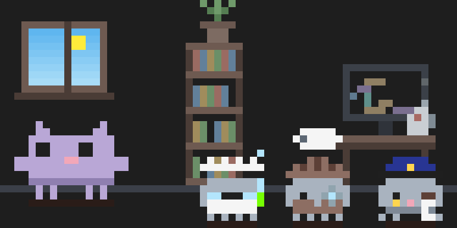
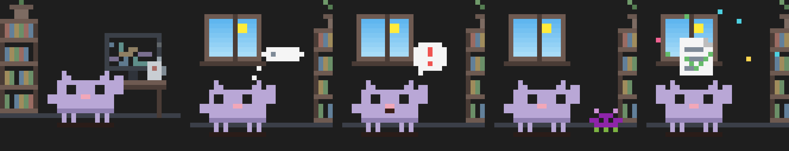
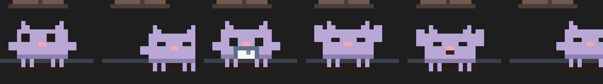
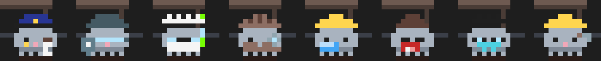
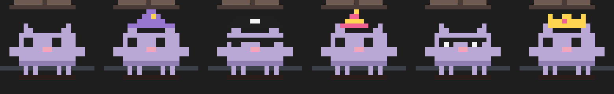

<div align="center">



# Mochi Crew

**A pixel-art cat that lives in your Claude Code side pane and reacts to what your session is really doing.**

Mochi types when Claude edits, grabs a hammer when a command runs, thinks along while Claude works,
and waves when it's your turn. Subagents join as a crew of kittens in role costumes. Fixed bugs,
green tests and shipped turns earn XP, missions and badges.

[Install](#install) · [What it does](#what-it-does) · [The crew](#the-crew) · [Controls](#controls) · [Privacy](#privacy-and-safety) · [Development](#development)

</div>

---

## Install

In Claude Code:

```
/plugin marketplace add joeVenner/mochi-crew
/plugin install mochi-crew@mochi-crew
```

Or from a shell:

```bash
claude plugin marketplace add joeVenner/mochi-crew
claude plugin install mochi-crew@mochi-crew
```

The pane opens on its own when a session starts. Run `/mascot` to open it again.

> **Tip:** Mochi is drawn with half-block pixels. If your terminal adds extra line spacing,
> setting it to `1.0` keeps the pixel art solid.

## What it does

Everything Mochi does comes from a real event in your session. Nothing is random or simulated.



| You see | When |
|---|---|
| Mochi walks to the desk and types while code races on the monitor | Claude runs `Edit`, `Write` or `NotebookEdit` |
| A jump with a green check and confetti, or a red cross | the edit succeeds or fails |
| A hammer, or a magnifier for read-only commands (`rg`, `ls`, `git status`) | `Bash` |
| A magnifier or an antenna | `Read`, or `WebSearch` / `WebFetch` and MCP tools (`calling Figma · get screenshot`) |
| A thought cloud (Mochi never naps mid-turn) | Claude is working on your prompt |
| A wave and a "!" bubble, and `Your turn · took 42s` | Claude hands the turn back |
| A purple bug scuttles in; the next passing command squashes it | a `Bash` command fails |
| A kitten walks in wearing its role costume and shows what it is doing | Claude starts a subagent |
| The real sky out the window: dawn, day, dusk, night | always, by your local time |

### A life between tasks

When nothing is happening, Mochi lives a little: looks around, strolls, sips coffee, reads,
stretches, yawns, and eventually naps. Each routine plays as a short scene on a slow beat, so it
feels alive without being distracting.



## The crew

Every subagent joins as a kitten in a costume picked from its type. Its HUD row shows the call it
is running right now (`run npm test`, `look notes.md`, `edit app.ts`), or `thinking` between calls.



| Type contains | Tag | Costume |
|---|---|---|
| security | `SEC` | SWAT helmet, visor, shield |
| review, verif, audit, lint | `AUD` | police cap and badge, clipboard |
| test | `TST` | goggles, lab coat, bubbling test tube |
| explore, search, research | `EXP` | deerstalker, trench coat, magnifier |
| plan, architect, design | `ARC` | hard hat, unrolling blueprint |
| guide, doc | `DOC` | bun, half-moon glasses, book |
| general, code, dev, engineer | `DEV` | glasses, tie, laptop |
| anything else | `WRK` | hard hat in its own color, hammer |

## The HUD

A quiet instrument panel under the room: dim labels, aligned numbers, thin bars in your theme's
accent color, and red or green only when something needs you.

```
▍ idle · reading
──────────────────────────────────────────
level     6  ━━━━━━━━━━━━━━━━━━━━━━━━  47/100
mood     90  ━━━━━━━━━━━━━━━━━━━━━━━━
energy   68  ━━━━━━━━━━━━━━━━━━━━━━━━
streak   x8  badges 4/6
──────────────────────────────────────────
next    Get the tests green  0/4
log     3 files · 5 turns · 4m 12s working
p: pet  f: feed  d: dance  o: outfit  s: sound
```

In a short pane it folds into a compact layout, so the controls never scroll away.

### Progress that means something

XP rewards progress, not keystrokes:

| Event | XP |
|---|---|
| A clean edit | 10, plus a streak bonus up to 10 |
| Editing a file already edited this turn | 3, and the streak holds |
| The turn's first passing test run (also a subagent's) | 10, once per turn |
| A turn that changed something and ended in an answer | 10 |
| Squashing a bug (a failed command that later passes) | 15 |
| Hiring a subagent | 5 |
| Each session mission | 20 |

A test run only counts when the suite really ran and passed: `npm test || true`, `npm test | tee log`
and `pytest --collect-only` don't.

**Missions** (once per session): get the tests green, ship 3 turns, fix a failing command, delegate
to a subagent. **Badges** (kept across sessions): First Hire, Full Crew, On Fire, Night Owl,
Bug Squasher, Veteran.

## Controls

Focus the pane (`ctrl+x tab`, or click it) and press:

| Key | Action |
|---|---|
| `p` | pet (hearts float up) |
| `f` | feed (a fish, caught mid-air) |
| `d` | dance |
| `o` | next outfit |
| `s` | sound on or off |

Commands:

```
/mascot                        open the pane
/mascot pet | feed | dance     interact without focusing the pane
/mascot journal                this session: turns and time, edits, commands, fixes, files
/mascot missions               this session's goals and progress
/mascot achievements           badges earned and how to earn the rest
/mascot outfits                list outfits
/mascot outfit <name>          classic, wizard, pirate, party, shades, crown
/mascot sound on|off           8-bit sound effects (off by default)
```



## Privacy and safety

- **Local only.** Nothing leaves your machine. The mod makes no network requests.
- **Secrets are masked on screen.** Commands shown in the HUD have tokens, auth headers, URL
  credentials and secret-looking env vars or flags replaced with `••••`. This affects the display
  only; your commands run unchanged.
- **Never in the way.** Every hook passes the tool call through untouched, even if Mochi's own
  bookkeeping fails, and all scoring happens after the result is already on its way back.
- **What is saved.** Level, XP, outfit, sound setting, mood, energy and badges persist in Claude
  Code's per-plugin store. The session journal and missions reset every session.

## Development

```bash
cd plugins/mochi-crew
claude plugin validate .
npx -y -p typescript@5.6.3 tsc -p .
claude plugin test .
```

The logic is pure and unit-tested in `hooks/*.ts`. `hooks/register.tsx` only wires engine events,
state and the pane.

| File | Responsibility |
|---|---|
| `register.tsx` | hooks, state, animation ticker, pane and HUD |
| `canvas.ts` · `world.ts` · `sprite.ts` · `workerArt.ts` | pixel canvas, the room, Mochi, the kittens |
| `behavior.ts` | walking, idle routines, sleep |
| `crew.ts` · `roles.ts` | subagent workers and their costumes |
| `turn.ts` · `progress.ts` · `game.ts` | turns, fair per-turn XP, levels |
| `journal.ts` · `missions.ts` · `achievements.ts` | session journal, missions, badges |
| `care.ts` · `events.ts` | mood and reactions, bugs and quips |
| `hud.ts` · `mascot.ts` · `redact.ts` | HUD layout, labels, secret masking |

## License

[MIT](LICENSE) © joeVenner

Mochi Crew is an independent community project. It is not affiliated with or endorsed by Anthropic.
Claude and Claude Code are trademarks of Anthropic.
