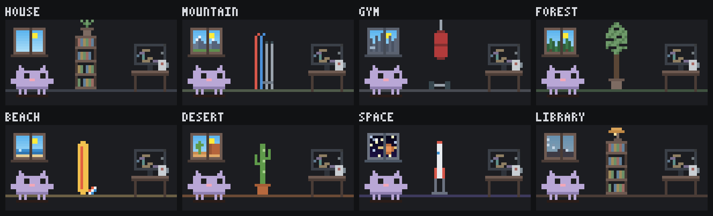

<div align="center">


# Mochi Crew

<sub><i>Mochi means "my cat" in Moroccan Darija.</i></sub>

**A pixel-art cat that lives in your Claude Code side pane and reacts to what your session is really doing.**

Mochi types when Claude edits, grabs a hammer when a command runs, thinks along while Claude works,
and waves when it's your turn. Subagents join as a crew of kittens in role costumes. Fixed bugs,
green tests and shipped turns earn XP, missions and badges. A session meter under the HUD shows
your model, context fill, prompt-cache hit rate, and plan limits or cost, and a file tree shows
where in the project Claude is working. With many sessions open, the session badge gives each
session its own place for Mochi's desk, color for its Terminal tab and emoji in its title. When
you want to check your own grasp of the work, Mochi Tutor quizzes you on the project and on what
Claude changed.

[Install](#install) · [What it does](#what-it-does) · [The crew](#the-crew) · [Session meter](#session-meter) · [File tree](#file-tree) · [Session badge](#session-badge) · [Tutor](#mochi-tutor) · [Controls](#controls) · [Privacy](#privacy-and-safety) · [Development](#development)

</div>

---

## Install

In Claude Code:

```
/plugin marketplace add joeVenner/mochi-crew
/plugin install mochi-crew@mochi-crew
```

Or from a shell:

```bash
claude plugin marketplace add joeVenner/mochi-crew
claude plugin install mochi-crew@mochi-crew
```

The pane opens on its own when a session starts. Run `/mascot` to open it again.

### Updating

New releases bump the plugin's version. To pick one up:

```
/plugin marketplace update mochi-crew
```

Or turn on auto-update once: open `/plugin`, go to **Marketplaces**, select `mochi-crew`, and choose
**Enable auto-update**. If an install from inside a session fails on a machine without a GitHub SSH
key, set `CLAUDE_CODE_PLUGIN_PREFER_HTTPS=1` and try again.

> **Tip:** Mochi is drawn with half-block pixels. If your terminal adds extra line spacing,
> setting it to `1.0` keeps the pixel art solid.

## What it does

Everything Mochi does comes from a real event in your session. Nothing is random or simulated.


| You see | When |
|---|---|
| Mochi walks to the desk and types while code races on the monitor | Claude runs `Edit`, `Write` or `NotebookEdit` |
| A jump with a green check and confetti, or a red cross | the edit succeeds or fails |
| A hammer, or a magnifier for read-only commands (`rg`, `ls`, `git status`) | `Bash` |
| A magnifier or an antenna | `Read`, or `WebSearch` / `WebFetch` and MCP tools (`calling Figma · get screenshot`) |
| A thought cloud (Mochi never naps mid-turn) | Claude is working on your prompt |
| A wave and a "!" bubble, and `Your turn · took 42s` | Claude hands the turn back |
| A purple bug scuttles in; the next passing command squashes it | a `Bash` command fails |
| A kitten walks in wearing its role costume and shows what it is doing | Claude starts a subagent |
| The real sky out the window: dawn, day, dusk, night | always, by your local time |

### A life between tasks

When nothing is happening, Mochi lives a little: looks around, strolls, sips coffee, reads,
stretches, yawns, and eventually naps. Each routine plays as a short scene on a slow beat, so it
feels alive without being distracting.


## The crew

Every subagent joins as a kitten in a costume picked from its type. Its HUD row shows the call it
is running right now (`run npm test`, `look notes.md`, `edit app.ts`), or `thinking` between calls.


| Type contains | Tag | Costume |
|---|---|---|
| security | `SEC` | SWAT helmet, visor, shield |
| review, verif, audit, lint | `AUD` | police cap and badge, clipboard |
| test | `TST` | goggles, lab coat, bubbling test tube |
| explore, search, research | `EXP` | deerstalker, trench coat, magnifier |
| plan, architect, design | `ARC` | hard hat, unrolling blueprint |
| guide, doc | `DOC` | bun, half-moon glasses, book |
| general, code, dev, engineer | `DEV` | glasses, tie, laptop |
| anything else | `WRK` | hard hat in its own color, hammer |

## The HUD

A quiet instrument panel under the room: dim labels, aligned numbers, thin bars in your theme's
accent color, and red or green only when something needs you.

```
▍ idle · reading
──────────────────────────────────────────
level     6  ━━━━━━━━━━━━━━━━━━━━━━━━  47/100
mood     90  ━━━━━━━━━━━━━━━━━━━━━━━━
energy   68  ━━━━━━━━━━━━━━━━━━━━━━━━
streak   x8  badges 4/6
──────────────────────────────────────────
next    Get the tests green  0/4
log     3 files · 5 turns · 4m 12s working
──────────────────────────────────────────
model   opus 5.5  plan
context  62  ━━━━━━━━━━━━━━━━━━━━━━━━  620k/1M
cache   91%  idle 2m
5h       34  ━━━━━━━━━━━━━━━━━━━━━━━━  7d 12%
p: pet  f: feed  d: dance  o: outfit  s: sound
```

In a short pane it folds into a compact layout, so the controls never scroll away. The meter
becomes one line there: `meter   ctx 62% · cache 91% · 5h 34%`.

### Progress that means something

XP rewards progress, not keystrokes:

| Event | XP |
|---|---|
| A clean edit | 10, plus a streak bonus up to 10 |
| Editing a file already edited this turn | 3, and the streak holds |
| The turn's first passing test run (also a subagent's) | 10, once per turn |
| A turn that changed something and ended in an answer | 10 |
| Squashing a bug (a failed command that later passes) | 15 |
| Hiring a subagent | 5 |
| Each session mission | 20 |
| A Mochi Tutor answer | 5 right, 2 right with a hint, 3 partly right; a round earns at most 35 ([details](#mochi-tutor)) |
| A due tutor flashcard rated good | 1, at most 10 per conversation |

A test run only counts when the suite really ran and passed: `npm test || true`, `npm test | tee log`
and `pytest --collect-only` don't.

**Missions** (once per session): get the tests green, ship 3 turns, fix a failing command, delegate
to a subagent. **Badges** (kept across sessions): First Hire, Full Crew, On Fire, Night Owl,
Bug Squasher, Veteran.

## Session meter

The last group of the HUD reads your session the way your provider means it. It appears after
Claude's first reply.

| Row | Meaning |
|---|---|
| `model   opus 5.5  plan` | the session's model, shortened from any provider's id, and who serves it (`plan`, `api key`, `bedrock`, `vertex`, `foundry`, `gateway`) |
| `context  62  ━━━  620k/1M` | context used against the model's window. It turns red from 85%, where auto-compact is close, and reads `–` right after a compact |
| `cache   91%  idle 2m` | share of the main conversation's input served from the prompt cache (subagents keep caches of their own and are left out). `cold` shows only once the cache has certainly expired |
| `5h  34  ━━━  7d 12%` | on a Claude plan: the fullest usage window as a bar, the others as a note |
| `cost    $4.12 est` | on per-token billing (API key, Bedrock, Vertex, Foundry): the list-price estimate |

A toast appears once when context reaches 80% or 90%, when a plan or spend window reaches 80% or
95%, or when prompt caching is never reported after three turns. That last one usually means a
gateway is stripping `cache_control`, so every turn bills as uncached input. A toast fires again only
after the figure falls 5 points below its line.

`/mascot meter` prints the full report: every figure, token totals, and notes for your provider.

| | Plan | API key | Bedrock | Vertex | Microsoft Foundry | Gateway |
|---|---|---|---|---|---|---|
| Limit row | 5h and 7d | none | none | none | none (Azure quotas are per minute) | spend limit, if set |
| Cost | not billed (only in `/mascot meter`) | estimate; the Console is the bill | estimate; AWS bills | estimate; Google bills | estimate; Azure bills (CCU) | estimate |
| Default cache TTL | 1h (5m on usage credits) | 5m | 5m (1h varies by model) | 5m | 5m | depends on the gateway |

How the provider is detected: a `CLAUDE_CODE_USE_BEDROCK`, `_MANTLE`, `_VERTEX`, `_FOUNDRY` or
`_ANTHROPIC_AWS` flag set to `1`, `true`, `yes` or `on` comes first. A gateway spend-limit window
comes next, then 5h/7d plan windows, which mark a plan even behind a proxy. After that, a
non-Anthropic `ANTHROPIC_BASE_URL` marks a gateway and an API key marks Console billing. A sign-in
whose plan windows haven't arrived yet shows no dollars. On Foundry, Claude Code assumes a 200K window
for a deployment name it can't map to a model, and `/mascot meter` points that out.

Sources, as of October 2026: Claude Code's docs on
[prompt caching](https://code.claude.com/docs/en/prompt-caching),
[costs](https://code.claude.com/docs/en/costs),
[Microsoft Foundry](https://code.claude.com/docs/en/microsoft-foundry) and
[environment variables](https://code.claude.com/docs/en/env-vars); Microsoft Learn on
[Claude in Foundry](https://learn.microsoft.com/en-us/azure/foundry/foundry-models/concepts/claude-models)
and [its quotas](https://learn.microsoft.com/en-us/azure/foundry/foundry-models/concepts/claude-models-quotas-limits);
AWS on [Bedrock prompt caching](https://docs.aws.amazon.com/bedrock/latest/userguide/prompt-caching.html).

## File tree

The bottom of the HUD shows the project as a tree, focused on this session's work: only the
folders that lead to files Claude edited are open, and the rest stay closed. Each folder lists the
edited files, and the folders holding them, first, so the session's work stays in view even in a
short pane.

```
──────────────────────────────────────────
files   mochi-crew  feat/file-tree
▸ docs
▾ plugins
  ▾ mochi-crew
    ▾ hooks
        editor.ts                 ?
      ● fileTree.ts          +12 M
      · register.tsx         +40 M
p: pet  f: feed  d: dance  o: outfit  s: sound  t: files
```

- `●` in the accent color is the file Claude is editing or reading now. It pulses while the turn
  runs.
- `·` marks files edited earlier in the session. A file a subagent edited is drawn in its kitten's
  hard-hat color.
- Badges come from git: `M` modified, `A` added, `D` deleted, `R` renamed, `?` untracked, and
  `+N` lines added since the last commit (untracked files have no count). A folder shows its
  totals, such as `+52 M:2`. Files inside a folder git has never seen get no badge until one of
  them is added, so a large vendored folder costs nothing.
- **Click a folder to open or close it.** Your choice holds for the session, except that a
  new edit inside a folder you closed opens it again, so fresh work is never hidden.
- **Click a file to open it in your editor.** `$VISUAL` or `$EDITOR` is used when it names a
  windowed editor (VS Code, Cursor, Windsurf, Zed, Sublime, JetBrains). Otherwise it opens in VS
  Code: with `code`, or on macOS the VS Code app itself when `code` isn't on your PATH. On
  Windows, VS Code's `code.cmd` needs a shell, so Mochi runs what it runs, `Code.exe` on its
  CLI script, directly. Without VS Code, macOS's default text editor opens it. A file is
  never handed to the system opener, which could run it (a `.command` file, say). Terminal
  editors such as vim are never started, since the pane has no terminal to give them.

**Worktrees.** The repository's other git worktrees show as sections of their own under the
project: a subagent's under `.claude/worktrees/`, or one you added beside the repo with
`git worktree add ../x`. Each is one row with its branch and git's totals, read in that worktree:

```
▸ agent-a18f4a8f  fix/learn-mods-launch  +40 M:3
▾ ui  feat/console-surface               +12 M:1
  ▾ src
    ● panel.tsx                          +12 M
```

A section opens when Claude or a subagent edits a file in it, and you can open or close one
with a click. Its files appear there, not deep under `.claude/worktrees/` in the project. Up to 8
worktrees are shown. A closed section costs one `git status`, while an open one is read like the
project itself.

The tree takes only the rows the rest of the HUD leaves. In a short pane it folds into one line,
such as `files   editing hooks/fileTree.ts`. Turn it off with `t`, the `files` button, or
`/mascot files off`.

## Session badge

With several sessions open, each one gets its own color and place, so you can pick the right one
at a glance:

- **Place.** Mochi's desk stands somewhere different in each session: the house, a mountain, the
  gym, a forest, the beach, the desert, a space station or a library. The window shows the place
  (with your local sky), a prop stands in the bookshelf's spot when the pane is wide enough for
  one, and the floor takes the place's color. This works in every terminal, Windows Terminal included. Each place goes with one color:

  | Color | Place | | Color | Place |
  |---|---|---|---|---|
  | 🟣 plum | space | | 🟠 rust | desert |
  | 🔵 harbor | beach | | 🟡 moss | mountain |
  | 🟢 pine | forest | | 🟤 walnut | library |
  | 🔴 claret | house | | ⚫ graphite | gym |

  

- **Tab tint.** In macOS Terminal.app the session's tab gets a dark background from eight colors
  (plum, harbor, pine, claret, rust, moss, walnut, graphite). Mochi picks the color the fewest other
  open tabs wear, and a session keeps its color through `/clear` and `/resume`. When the session
  ends, Mochi re-applies the tab's profile (which also undoes other changes made to that tab), unless
  you recolored it yourself meanwhile. Over ssh, Mochi leaves your tabs alone.
- **Emoji title.** The tab title leads with the matching emoji: `✳ 🟣 SEO hub pages`. The topic is
  the one Claude Code generates from your first message, so it appears from your second prompt.
  Claude Code writes that topic once; change it with `/rename` or `/mochi badge title`. A
  `/rename` always wins and Mochi only adds the emoji.

The place and the title work in any terminal; the tint needs Terminal.app, as no other terminal
lets a plugin recolor an open tab. The first time, macOS may ask to let Claude Code control
Terminal: allow it for the tint. The emoji reaches the tab only while
`terminalTitleFromRename` is on, which is Claude Code's default. Turn the badge off for good with
`/mochi badge off`, which also brings Mochi back to the house.

## Mochi Tutor

When Claude writes most of the code, it is easy to ship changes you couldn't explain. Mochi Tutor
quizzes you on this project and on what Claude changed, so you understand what you ship. Press `q`
in the pane, or run `/mascot tutor`, and it opens in a tab of its own. Nothing is sent to a model
until you start a round. The first time, a notice says what a round sends: `y` accepts it, `n`
closes the tab. One yes covers every project. The notice asks again after `/mascot tutor reset`, or
when an update changes what it describes.

```
▍ Mochi Tutor              LV 2 · 4 rounds
──────────────────────────────────────────
What should I quiz you on?
ctx  session · warm (2m idle)
──────────────────────────────────────────
1: recent changes   the diff + commits
2: last turn        why Claude did it
3: big picture      how the parts fit
r: review 3 missed  no model call
g: use digest instead  x: close
```

| Focus | Mochi asks about |
|---|---|
| `1` recent changes | the changes made in this session and the latest commits |
| `2` last turn | the reasoning behind Claude's last answer: why that approach, and what the alternatives were |
| `3` big picture | how the parts of the project fit together: which module does what, and how data flows between them |

**Where a round comes from.** A round is five questions, written in one request (a second only if a fork
falls back). The `ctx` line says how the next one will be made before you press:

- **This session.** While Claude is working, or within 5 minutes of its last reply, Mochi asks this
  conversation one extra question (a fork). It knows why things were done, and its prompt cache is
  surely still warm then: 5 minutes is the shortest cache lifetime any account has. The line reads
  `session · warm (2m idle)` or `session · Claude is working`.
- **A digest.** Otherwise Mochi sends `tutorModel` (haiku by default) a digest of the diff, commit
  subjects and short chat excerpts, at most 16,000 characters ([what it holds](#privacy-and-safety)).
  The line says why: `digest · cache may have lapsed (idle 12m)`, `digest · cache cold (idle 1h)`,
  `digest · no reply yet`, `digest · model changed` (after `/model`, the chat's cache belongs to the
  old model), `digest · chat too large (412k)` (over 300k tokens), `digest · chat size unknown`,
  `digest · last fork missed the cache`, `digest · set in /config` or `digest · you chose it`.
  With `tutorContext: session` it reads `session · forced in /config`.
- `g` makes the next round use the digest instead. It is shown only when that round would otherwise
  be a fork.
- If a fork can't make a quiz (nothing to fork yet, an empty or malformed reply, an error, or no
  reply within 60 seconds), the round asks the digest once instead. A rate limit or an overloaded
  API is the exception: the round stops with that error, and `d` tries the digest. A fork can't be cut short: `x`
  stops waiting, but the request still finishes and counts. If a fork turns out to have missed the
  cache, the summary says how many tokens it re-read, and rounds use the digest until Claude replies
  again.

Spending shows in tokens, never dollars: the summary has the round's cost, and Home has the
session's (`this session  2 rounds · 9.8k in · 151k cached · 2.1k out`).

**Questions.** Each one is tagged `WHAT`, `HOW`, `WHY` or `WHAT IF`, and names the file it is about
when that is a file the round was shown.

- **Choice** (2 to 4 options, press the number): after you answer, Mochi gives the reason the right
  option is right, and why the one you picked is not (when you got it right and the pane is tall
  enough, why another option is not).
- **Which line** (2 to 4 lines of one code card, press the number): a choice whose options are
  lines of the diff, read as `L42  <line>`, or `old L42` for a removed line. It is checked on your
  machine, with no request, and explained like a choice.
- **In your own words**: type an answer and press Enter. `tutorModel` checks it against a reference
  answer and its key points, and says `✓ solid`, `◐ partly` or `✕ missed`, with each point marked.
  `r` shows the answer instead and you grade yourself, as you also do if the check fails.
- **Hints** (`h`) come with the round and cost no request, but they lower the XP for that answer.
  `s` skips a question.
- **Follow-ups.** After an answer, Tab to the `ask` field (or click it) to ask about that question:
  up to 2 per question and 6 per round. `tutorModel` answers in a few sentences, never the session
  itself. On a digest round it also sees the diff excerpt of the question's file. `o` opens that
  file in your editor when it is one Claude or a subagent edited in this session, in the project
  itself rather than a worktree (terminal only).

**Code cards.** A question can point at a line of the diff, and Mochi then draws that part of the
change under the question, as a diff with its file and line (`src/x.ts · line 42`). The code is
never written by the model: the model only names a file and quotes a line, and Mochi cuts the
lines from a masked diff it made itself, so a masked secret stays masked on the card. A quote that
doesn't match the diff exactly drops the code (and a which-line question whole). Only changes to
files git tracks have code cards; a new file not yet added has none. A card shows up to
16 lines, 8 in a short pane, and only its caption (`code: src/x.ts line 42 · make the pane taller
to see it`) when the pane is too short. Questions and answers sit in a rounded frame: Claude's
orange for a question or flashcard, green for a right answer, red for a wrong one, dim otherwise.

The summary shows the score, XP and level, up to three `file · symbol` places to read next (from the
questions you missed, half got, needed a hint for or skipped), and how many cards come back. `r`
replays the missed questions without a request or XP, and `n` goes back to Home for a new round.

**Review deck.** A question you missed, half got, skipped or needed a hint for becomes a card for
this project, and so does any other question you keep with `k` on its answer screen. When a card is
due, one joins each new round, and `r` on Home runs a review round of
up to five due cards with no request at all. A card answered right without a hint comes back after 3
rounds, then 6, and is then retired as mastered; any other answer brings it back next round. A
project keeps up to 20 cards. When the deck is full, the cards closest to mastered make room for new
misses and kept cards. Cards are saved questions, so they say `from an earlier round · the code may have changed`;
a saved code card keeps the code as it was then.

**Flashcards.** `c` on Home (`cards (12)`, or `cards (3 due)` when some are), on the summary or on
the flashcards' tally, and `/mascot tutor cards`, go through the deck as flip cards: due cards
first, then the rest, lowest box first, at most 10. The front shows the question and its code
card; `f` flips it to the answer. Then rate how well you knew it:

| Key | Rating | What happens to the card |
|---|---|---|
| `1` | again | back to the first box, due after the next round |
| `2` | hard | stays in its box, due after the next round |
| `3` | good | a due card moves up a box as a right review answer does, and from the last box is mastered; a card not due yet stays as it is (`not due yet: kept in box 2`), so flipping ahead can't cram it |

The schedule counts quiz rounds, so a flashcard session never makes cards due by itself. Each rating
is saved at once, so leaving partway keeps them. `x` ends the session with a tally
(`Flashcards: 7 rated · 4 good · 2 hard · 1 again · +4 XP`, and how many are now mastered); from
there `c` goes again and `h` goes Home. Flashcards make no request and send nothing, but they open
only once the first-use notice is accepted.

**XP and level.** Answers earn Mochi's XP: 5 for right, 2 for right with a hint, 3 for partly right,
nothing for wrong or skipped. A perfect round of at least four questions with no hints adds 10, and a
round earns at most 35. Review rounds earn half, with no bonus, and replays earn nothing. A
flashcard rated good when it was due earns 1, at most 10 per conversation, and other ratings earn
nothing. Apart from
that, the tutor keeps a level from 1 to 3 for each project (`LV` on Home). Two rounds in a row of at
least four questions at 80% or more, with at most one hint, move it up; a round at 40% or less moves it down. Level 1 asks
what and how, level 2 asks why, and level 3 asks about trade-offs and what breaks if something
changes. Topics you mastered are not asked again, and recent misses are.

While a question is on screen, the main HUD reads `quizzing you · q 2/5`, and during flashcards
`flashcards · 3/10`.

**Mobile.** Every screen works by its buttons. Choice and which-line questions and flashcards work
as usual. Questions in your own
words show the answer and you grade yourself, and there are no follow-ups.

**Settings,** in `/config`:

| Option | Values | Meaning |
|---|---|---|
| `tutorModel` | `haiku` (default), `sonnet`, `opus` | the model for digests, grading and follow-ups. A fork uses the session's own model |
| `tutorContext` | `auto` (default), `digest`, `session` | `auto` works as above. `digest` never reuses the chat. `session` always forks once Claude has replied, even when the cache may have lapsed, and then the `ctx` line turns red: `session · maybe warm (idle 12m): full price if the cache lapsed` |

A `/config` change reloads the mod and drops a round in progress.

The tab is a second pane. Opened from the main pane, it usually doesn't take the keys, and a toast
says to press `ctrl+x tab` or click it. Esc hands the keys back to the prompt, and the round waits.

## Controls

Focus the pane (`ctrl+x tab`, or click it) and press:

| Key | Action |
|---|---|
| `p` | pet (hearts float up) |
| `f` | feed (a fish, caught mid-air) |
| `d` | dance |
| `o` | next outfit |
| `s` | sound on or off |
| `t` | file tree on or off |
| `b` | next place for Mochi's desk (the session's color comes with it) |
| `q` | open the Mochi Tutor tab (it never starts a round by itself) |

In the tutor tab:

| Key | Action |
|---|---|
| `y` · `n` | accept the first-use notice, or close the tab for now |
| `1` `2` `3` | on Home, start a round on recent changes, the last turn or the big picture |
| `r` | on Home, review missed questions; on a question in your own words, show the answer; on the summary, replay the missed ones |
| `g` | on Home, use the digest for the next round, or go back to the session (shown only when the round would be a fork) |
| `c` | on Home, the summary or the flashcards' tally, start flashcards (shown while the deck holds a card) |
| `1`-`4` | answer a choice or which-line question |
| Enter | check a typed answer, or send a follow-up |
| Tab | move between the text field and the buttons (follow-ups are asked in the `ask` field) |
| `h` · `s` | show the hint, skip the question |
| `1` `2` `3` | after a revealed answer: I had it, partly, I missed it |
| `n` | next question, or finish; on the summary, back to Home for a new round |
| `k` | on an answer, keep the question as a flashcard (gone once the deck holds it, and not on review questions) |
| `o` | open the question's file in your editor (terminal only, and only a file edited in this session) |
| `f` | on a flashcard, flip it |
| `1` `2` `3` | on a flashcard's answer: again, hard, good |
| `h` | on the flashcards' tally, back to Home |
| `t` · `d` | after an error, try again, or try the digest instead (after a failed fork) |
| `x` | close, end the round, cancel a request, or stop waiting for a fork; on a flashcard, end the session with its tally (or go Home if nothing was rated) |
| Esc | hand the keys back to the prompt; the round waits |

Every key is also a button you can click.

Commands:

```
/mascot                        open the pane (/mochi works too, for every command below)
/mascot pet | feed | dance     interact without focusing the pane
/mascot journal                this session: turns and time, edits, commands, fixes, files
/mascot missions               this session's goals and progress
/mascot achievements           badges earned and how to earn the rest
/mascot meter                  the session meter in full, with notes for your provider
/mascot files [on|off]         show or hide the file tree (on by default)
/mascot tutor                  open the Mochi Tutor tab
/mascot tutor start | digest   start a round as the `ctx` line says, or always from the digest
/mascot tutor review           a review round of missed questions, with no model request
/mascot tutor cards            flashcards over this project's review deck, with no model request
/mascot tutor stop             end the round, or stop waiting for a reply
/mascot tutor reset            clear this project's tutor level, rounds and review deck, and the
                               notice's yes (shared by every project, so the next round asks again)
/mascot badge                  this session's color and title
/mascot badge on|off           tint the tab and add the emoji title, or stop (on by default)
/mascot badge color <name>     plum, harbor, pine, claret, rust, moss, walnut, graphite
/mascot place [<name>]         list the places, or move Mochi (its color comes with it)
/mascot place next             the next place, as the pane's b key does
/mascot badge title <text>     pin this session's title; /mascot badge auto follows the topic again
/mascot outfits                list outfits
/mascot outfit <name>          classic, wizard, pirate, party, shades, crown
/mascot sound on|off           8-bit sound effects (off by default)
```


## Privacy and safety

- **Local, except the tutor when you use it.** The pet, HUD, meter, journal, file tree and badge
  make no network requests of their own. The session badge's title is handed to Claude
  Code the way a `/rename` is, and Claude Code handles it like any session name. The session
  meter reads figures Claude Code already has, plus the provider-selection and cache-TTL environment
  variables by name. It asks only whether the session uses a key or a sign-in, never for the
  credential itself.
- **Mochi Tutor sends data to a model only when you press.** Checking a typed answer and asking a
  follow-up each make one request, and so does starting a round (two if a fork falls back to the
  digest). All go through Claude Code's own client and account, and they count toward your usage. A
  round either asks this session's own conversation one extra question (a fork, on the session's
  model), or it sends `tutorModel` (haiku by default) a digest. With `tutorContext: auto`, a fork
  happens only while Claude is working or within 5 minutes of its last reply, when the prompt cache
  is surely warm; with `session` it can happen later, when a lapsed cache bills the conversation
  again, and the tab says so first. A fork adds the names of files this session touched and recent
  commit subjects to the conversation, tool output and all, that Claude Code already sent; Mochi
  masks only what it adds. Both kinds of round also send your tutor level and the topics you
  mastered or recently missed. The digest holds at most 16,000 characters: the folder name and
  branch, recent commit subjects, the names and `git diff HEAD` excerpts of every uncommitted change
  to tracked files in this folder, staged or not and removed lines included (files Claude touched in
  this session first, then by lines added; past 150 files the rest are only counted), the first 60
  lines of up to two new files this session touched, for
  the big-picture focus a folder layout from `git ls-files` names, your last few prompts, short
  excerpts of Claude's replies (for the last-turn focus, its last reply, up to 1,200 characters),
  and tool names with file paths. Grading sends the question, its
  reference answer and key points, and your answer. A follow-up sends the question with its answer
  and reasons, your answer, your last two follow-ups on it, your message and, on a digest round, the
  diff excerpt of the question's file. The digest, grading and follow-ups never include tool output,
  command text or other file contents. Flashcards and which-line answers make no request and send
  nothing.
- **Code cards show only masked diff, and send none.** On a digest round a card is cut from the
  excerpt the digest already sent. On a fork round, when the reply points at files (at most 5, all
  edited in this session in the project itself), Mochi runs one more local `git diff` for just those
  files, in the same two steps, with the same rename check, masking, 1 MB cap and timeout as the
  digest. Its output is only drawn and never sent, except that a follow-up on a which-line
  question sends that question's options, the lines the model itself quoted, as the card shows
  them. If git fails, the questions stay and lose only their code.
- **Files meant for secrets are never diffed or read.** They are matched by name, in any folder and
  ignoring case: `.env*`, `*secret*`, `*credential*`, private keys (`id_rsa*`, `id_dsa*`,
  `id_ecdsa*`, `id_ed25519*`, `*.key`, `*.pem`, `*.p8`, `*.ppk`), certificate and key stores
  (`*.p12`, `*.pfx`, `*.jks`, `*.keystore`, `*.kdbx`), `*.gpg`, `*.asc`, `.npmrc`, `.netrc`,
  `.pgpass`, `.htpasswd`, `.pypirc`, `.dockercfg`, `.docker/config.json`, `.kube/config`,
  `kubeconfig`, `.vault-token`, Terraform state and `*.tfvars`, `config/database.yml`,
  `application*.properties`, and anything under `.aws/`, `.ssh/` or `.gnupg/`. Lock and minified
  files, `dist/` and `node_modules/` are left out too. Mochi lists the changes first, with git's
  rename and copy detection, and diffs only paths whose old and new names both pass, so
  `git mv .env notes.txt` stays out. A new file is read only when it is a regular file, not a link,
  at most 200 KB, and lands inside the project under a name that passes. The names of such files
  can still appear where a round lists paths (the tool trail, a fork's file list). Each tutor git
  call's output is capped at 1 MB.
- **Common secret patterns are masked, not every secret.** In everything Mochi adds, typed answers
  included, private-key blocks are removed, and tokens and API keys of well-known shapes, auth
  headers, URL credentials and secret-named values (`API_KEY=…`, `password: …`) are masked, in diff
  lines and file names too. Masking works by pattern, so it can miss a secret in an unusual form.
  A secret copied, or moved and mostly rewritten, under an ordinary name is not a rename to git,
  so only masking guards it.
- **Model replies are only drawn.** They are shown as plain text, with tabs turned into spaces and
  control, invisible and bidirectional characters replaced, and are never run or sent back to the
  session. Nothing runs in the background, and `tutorContext: digest` never reuses the chat.
- **Local commands, no shell.** The file tree lists folders on the way to edited files and runs
  `git rev-parse`, `git status`, `git diff --numstat`, `git branch` and `git worktree list` in the
  project (and `git status` and `git diff` in its worktrees), and a tutor round runs `git rev-parse`,
  `git log`, `git diff` and `git ls-files` in the project, all without taking git's index lock and
  with the repository's fsmonitor command turned off. File and branch names are drawn with control,
  invisible, bidirectional and tag characters replaced. Clicking a file runs your editor with that
  file's path. Commands run by argument list, never through a shell, and only for files that
  resolve inside the project or inside a worktree git lists for it. The session badge runs `ps` to find this session's tab,
  `osascript` to read and set Terminal.app tab colors (with every value passed as an argument,
  never as script text), and `grep` to read Claude Code's topic from the session transcript (on
  Windows, which has no `grep`, it reads that file instead). Titles it sets are drawn from that
  topic or your own words, with control characters removed.
- **Secrets are masked on screen.** Commands shown in the HUD have common secret patterns replaced
  with `••••`: tokens and API keys of well-known shapes (GitHub, Slack, AWS, Stripe, Google, JWTs
  and others), auth headers, URL credentials, secret-looking env vars or flags, and secret-named
  `name: value` or `name = value` settings. An unusual secret can still show. This affects the
  display only; your commands run unchanged.
- **Never in the way.** Every hook passes the tool call through untouched, even if Mochi's own
  bookkeeping fails, and all scoring happens after the result is already on its way back.
- **What is saved.** Level, XP, outfit, sound setting, the file tree switch, mood, energy and
  badges persist in Claude Code's per-plugin store. So do the session badge switch and, for the 300
  most recent sessions, each one's color, a title you pinned and the last few titles Mochi set,
  which include Claude Code's topic for that session. So do the tutor's consent (one for every project) and, for up to 12
  projects (fewer when their decks are large, as the oldest projects go first to keep the store
  small), each one's tutor level, streak and round count, up to 20 missed or kept questions to review
  (with their options and reasons, as the model wrote them, and for a code card up to 16 lines and
  1,600 characters of Mochi's own masked diff), and the topics mastered and recently missed. The
  session journal, missions, meter and the tree's touched files reset every session,
  and so does a tutor round left unfinished.

## Development

```bash
cd plugins/mochi-crew
claude plugin validate .   # manifest and hooks
claude plugin test .       # the test suite
```

Type-checking (`npx -y -p typescript@5.6.3 tsc -p .`) uses the engine type definitions that Claude
Code writes to `.claude-plugin/types/` when it loads the plugin, so load it once (install it, or
start Claude Code with `--plugin-dir plugins/mochi-crew`) before running `tsc`.

The promo video lives in [`promo/`](promo/README.md), a Remotion project that draws Mochi with the
plugin's own renderer, plus a cover still (`npm run thumbnail`). It is not part of what the
marketplace installs.

### Releasing

This repository is itself a Claude Code plugin marketplace: `.claude-plugin/marketplace.json` at the
root lists the plugin in `plugins/mochi-crew`. Users keep a cached copy and receive a new one only
when the plugin's version changes, so for every release:

1. Bump `version` in `plugins/mochi-crew/.claude-plugin/plugin.json` (the only place it is set).
2. Run `claude plugin validate .` from the repository root.
3. Merge to `main`. Users get it with `/plugin marketplace update mochi-crew`, or automatically if
   they turned on auto-update.

The logic is pure and unit-tested in `hooks/*.ts`. `hooks/register.tsx` only wires engine events,
state and the pane.

| File | Responsibility |
|---|---|
| `register.tsx` | hooks, state, animation ticker, pane and HUD, session meter, file tree and tutor wiring |
| `canvas.ts` · `world.ts` · `sprite.ts` · `workerArt.ts` | pixel canvas, the room and its places, Mochi, the kittens |
| `behavior.ts` | walking, idle routines, sleep |
| `crew.ts` · `roles.ts` | subagent workers and their costumes |
| `turn.ts` · `progress.ts` · `game.ts` | turns, fair per-turn XP, levels |
| `journal.ts` · `missions.ts` · `achievements.ts` | session journal, missions, badges |
| `care.ts` · `events.ts` | mood and reactions, bugs and quips |
| `hud.ts` · `mascot.ts` · `redact.ts` | HUD layout, labels, secret masking |
| `fileTree.ts` · `editor.ts` | file tree: git parsing, the focused tree and its window; the editor launcher |
| `meter.ts` · `meterRows.ts` · `meterAlerts.ts` · `meterReport.ts` | session meter: provider detection and figures, HUD rows, alerts, `/mascot meter` |
| `badge.ts` · `badgePalette.ts` · `badgeTitle.ts` · `badgeTty.ts` · `badgeTerminal.ts` · `badgeRecords.ts` · `badgeCommand.ts` | session badge: lifecycle, colors, titles, finding the tab, Terminal.app, saved records, `/mascot badge` |
| `tutorPlan.ts` · `tutorDigest.ts` · `tutorPrompt.ts` · `tutorParse.ts` · `tutorRound.ts` · `tutorProgress.ts` · `tutorCards.ts` · `tutorCode.ts` · `tutorView.ts` | Mochi Tutor: fork or digest, the masked digest, prompts, quiz parsing, rounds and scoring, saved progress, flashcards and kept cards, code cards cut from the diff, the tab's rows |

## License

[MIT](LICENSE) © joeVenner

Mochi Crew is an independent community project. It is not affiliated with or endorsed by Anthropic.
Claude and Claude Code are trademarks of Anthropic.
